<div align="center">

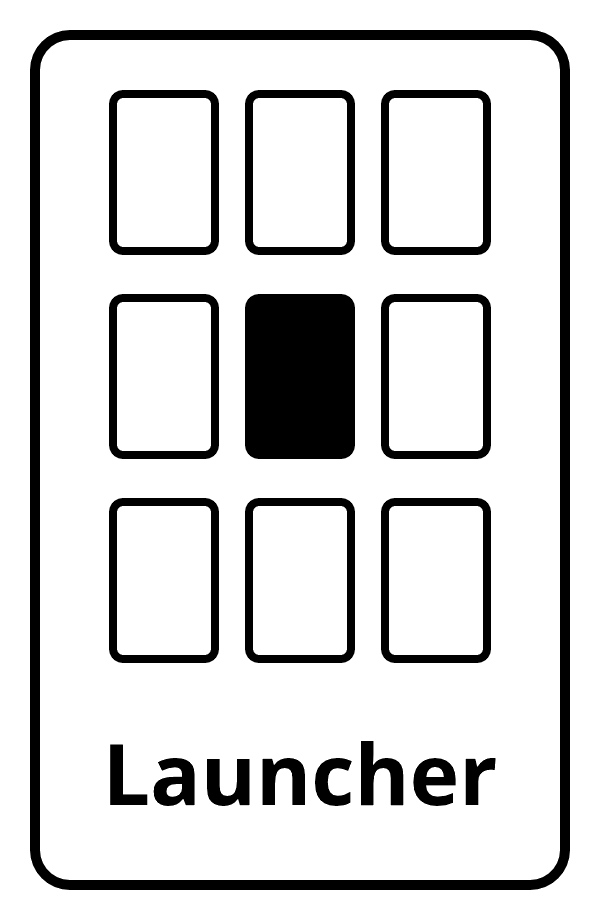

# Primitive Launcher

**A home screen for jailbroken Kindle e-readers.**
Written in Rust. It replaces the stock Kindle home with a grid of your apps, on grayscale e-ink.

[](https://github.com/DoanNguyenTrong/kindle-primitive-launcher/actions/workflows/ci.yml)
[](https://github.com/DoanNguyenTrong/kindle-primitive-launcher/releases)
[](https://github.com/DoanNguyenTrong/kindle-primitive-launcher/tags)
[](LICENSE)
[](https://github.com/DoanNguyenTrong/kindle-primitive-launcher/stargazers)

[**Download**](https://github.com/DoanNguyenTrong/kindle-primitive-launcher/releases/latest) ·
[**Install guide**](docs/INSTALL.md) ·
[**Plan**](docs/03-plan.md) ·
[**Changelog**](docs/CHANGELOG.md)

</div>

---

Primitive Launcher is the interface of a jailbroken Kindle for people who read in KOReader, browse with
[Primitive Browser](https://github.com/DoanNguyenTrong/kindle-primitive-browser) and run KUAL extensions. Every
app is an icon on one grid. While the launcher runs, the stock Kindle framework is stopped, which leaves the
apps about 140 MB more memory. The stock Kindle UI stays installed and unchanged, one tap away, and it is what
every failure falls back to.

<table>
  <tr>
    <td align="center">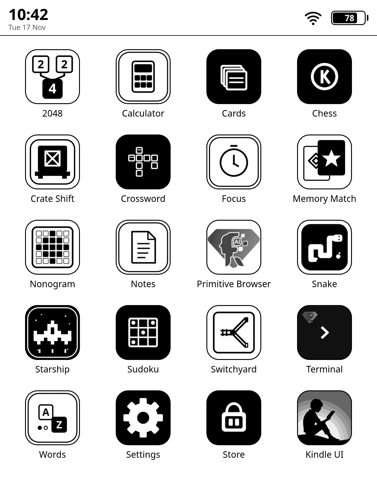<br><sub>The home screen</sub></td>
    <td align="center">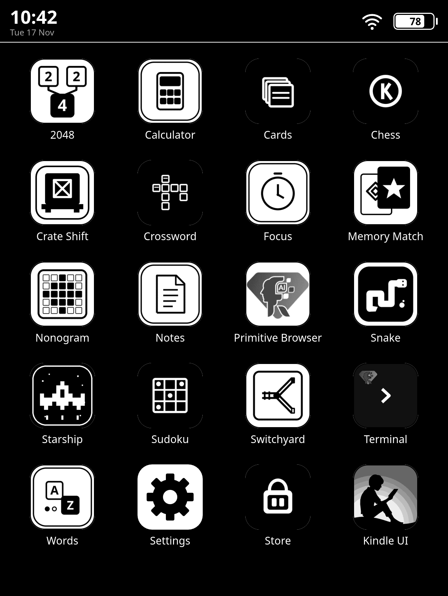<br><sub>Dark mode</sub></td>
    <td align="center">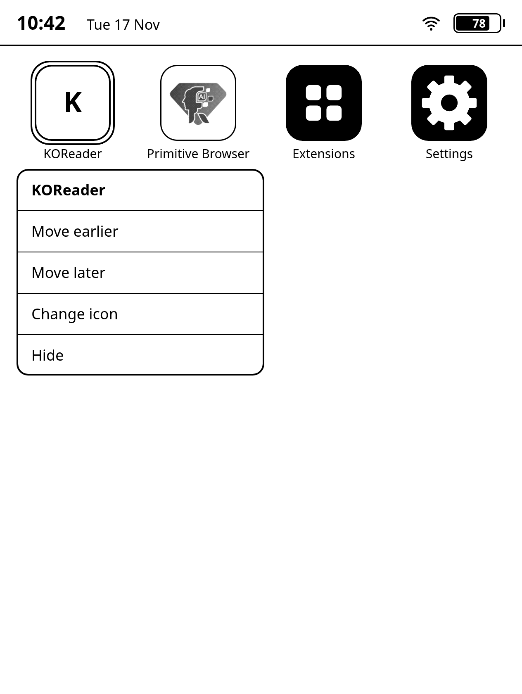<br><sub>Long press: the app menu</sub></td>
  </tr>
  <tr>
    <td align="center">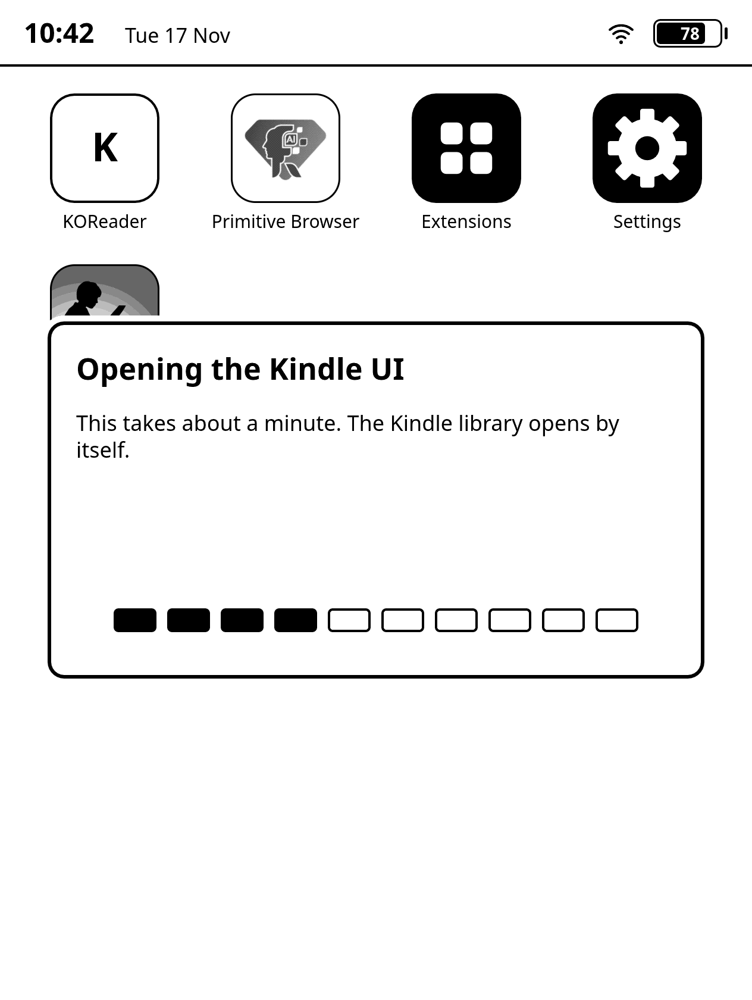<br><sub>Back to the Kindle UI</sub></td>
    <td align="center">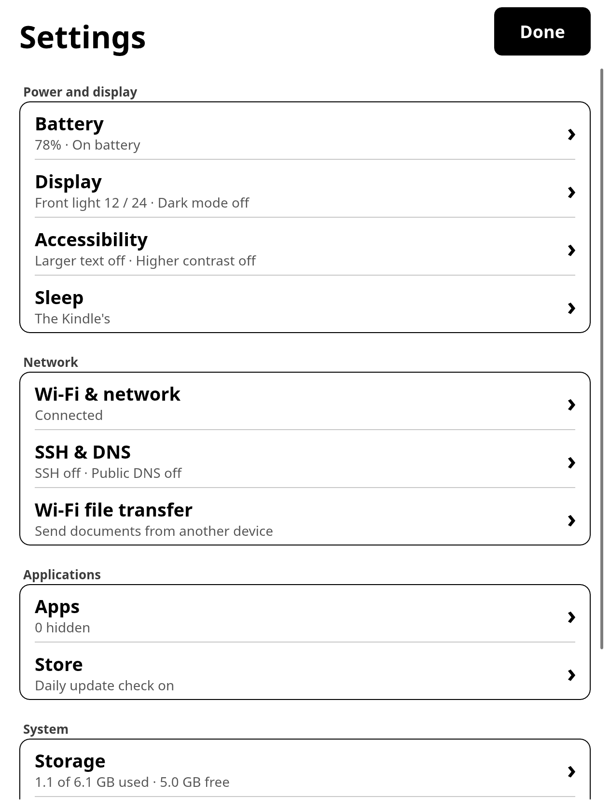<br><sub>Settings</sub></td>
    <td align="center">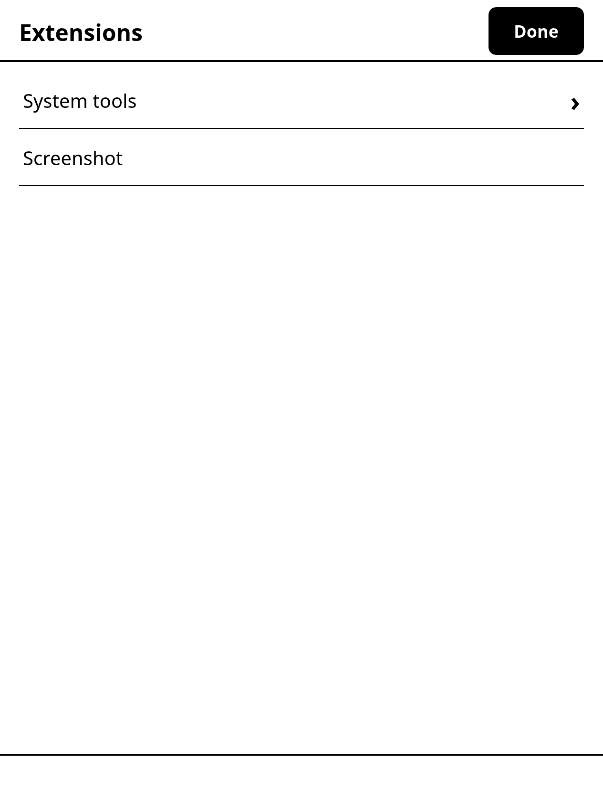<br><sub>KUAL extensions</sub></td>
  </tr>
</table>

<sub>Screenshots are from the desktop build of the same code, with a demo battery (78%), a fixed clock and a demo
extension. They are not photos of a device.</sub>

## Why this exists

On a jailbroken Kindle that is used for KOReader and other apps, the stock home screen is mostly in the way.

- **Memory.** The stock framework (the Java UI, the library, the store) keeps running behind every app. With it
  stopped, the memory available to apps went from about 170–200 MB to about 310–340 MB on the Oasis 3
  ([device notes](docs/device-notes.md)).
- **Getting to apps.** KOReader, Primitive Browser and extensions are entries in the library, mixed with books,
  or one more menu away in KUAL.
- **Coming back.** Apps started from the stock UI return to the library, and the framework they stopped has to
  start again, which takes about a minute.

**What this project does instead.** One home screen holds every app. The launcher stops the framework once,
runs apps, and takes the screen back when they exit, without restarting the framework in between. The stock UI
is used only when you ask for it, or when something goes wrong.

## Quick start

1. **Download** `primitive-launcher-<version>.zip` from the [latest release](https://github.com/DoanNguyenTrong/kindle-primitive-launcher/releases/latest).
2. **Copy** the `launcher` and `documents` folders onto your jailbroken Kindle's root, from the stock Kindle UI.
3. **Open** *Launcher* in the Kindle library.

The full steps, upgrades and removal are in the [install guide](docs/INSTALL.md).

## Why it is better

- **A clean screen.** One grid of your apps replaces the stock home, with its library shelves, store and banners. Only
  what you use is on the screen, and e-ink redraws just the part that changed.
- **Less memory.** With the stock framework stopped, apps have about 140 MB more memory on the Oasis 3
  ([device notes](docs/device-notes.md)).
- **Quicker to be useful at boot (opt-in).** With the boot start on, the launcher opens when the stock start-up animation
  has finished, instead of waiting for the stock home screen.
- **One place for settings.** Wi-Fi and networks, SSH and DNS, display, sleep, device and about, in pages you can read
  at a glance, and a quick panel from the top edge with the same controls.

## Screenshots

The screenshots are from the desktop build of the same code, with demo values. They are not photos of a device.

<table>
  <tr>
    <td align="center">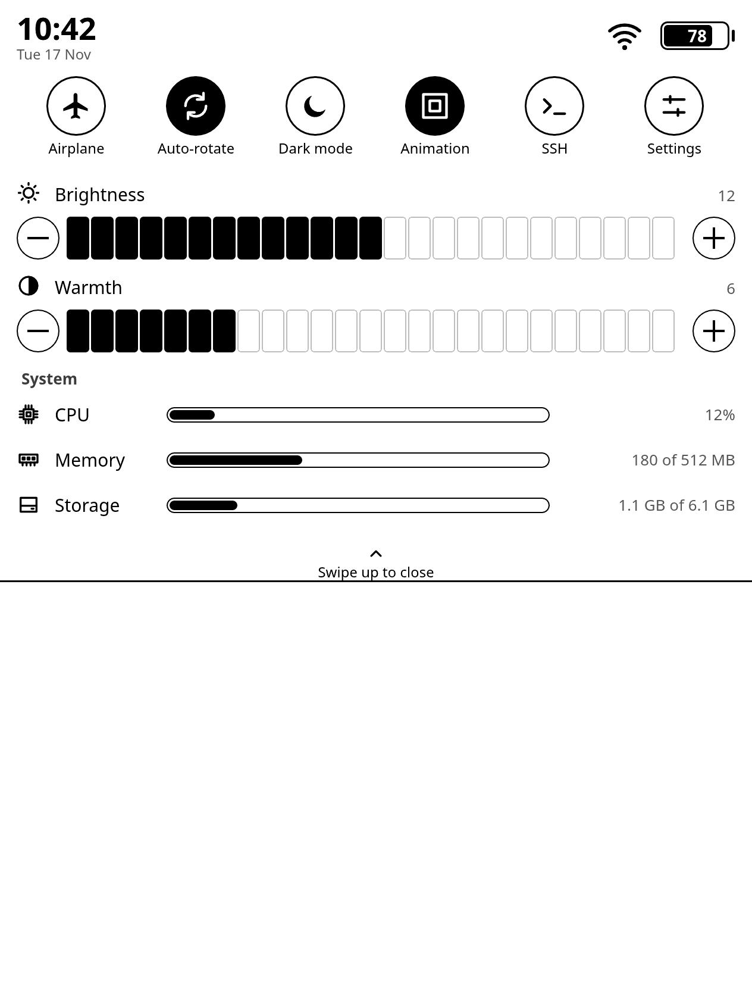<br><sub>Quick settings, with CPU, memory and storage</sub></td>
    <td align="center">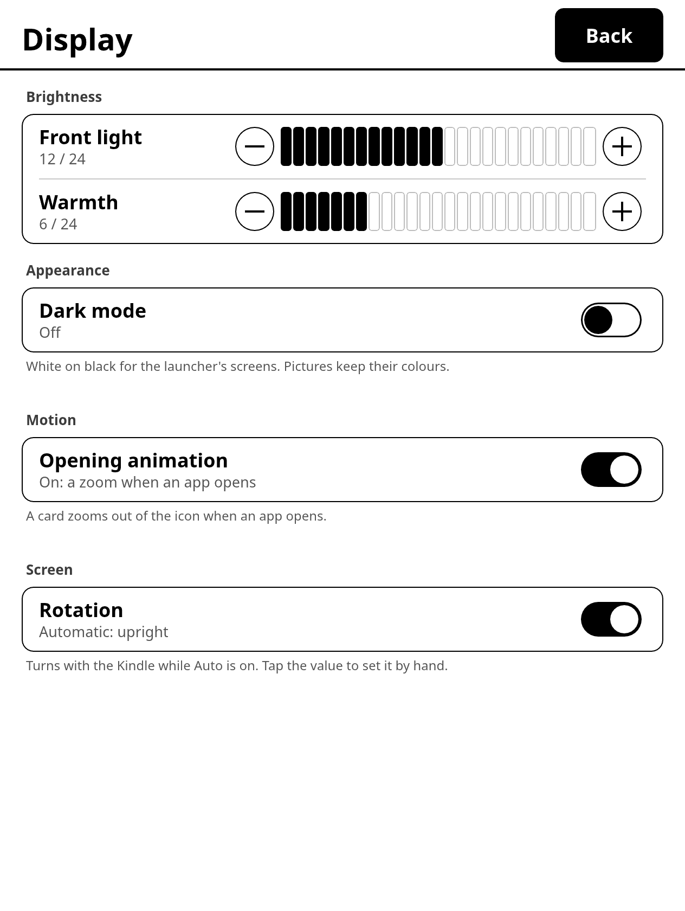<br><sub>Display settings</sub></td>
    <td align="center">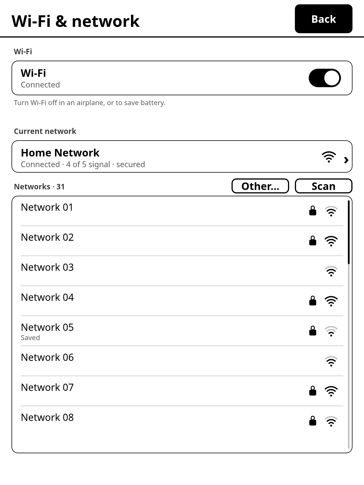<br><sub>Wi-Fi and the networks in range</sub></td>
  </tr>
  <tr>
    <td align="center"><br><sub>A long list of networks, with scrolling</sub></td>
    <td align="center">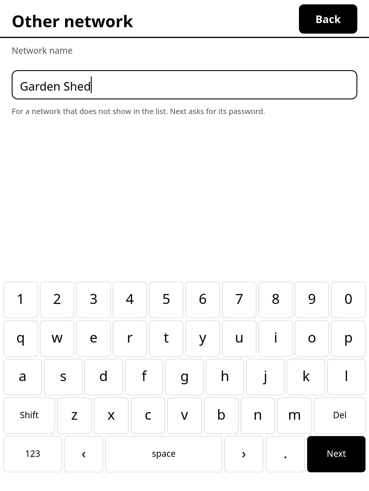<br><sub>Joining a hidden network by name</sub></td>
    <td align="center">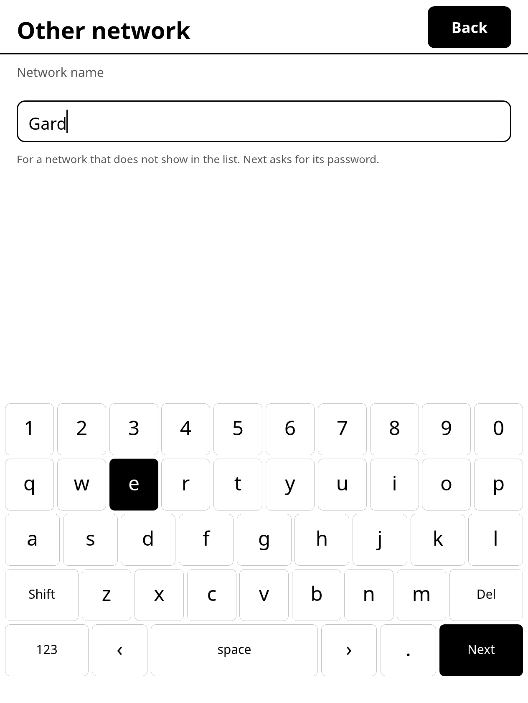<br><sub>The on-screen keyboard, with a key pressed</sub></td>
  </tr>
  <tr>
    <td align="center">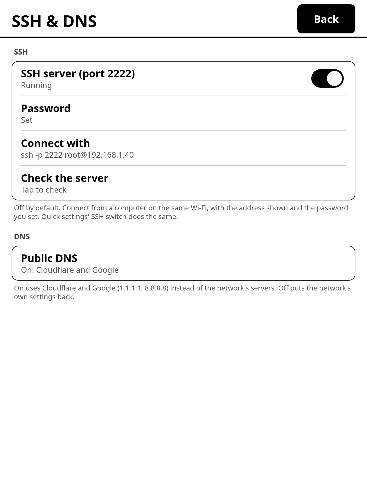<br><sub>SSH and DNS settings</sub></td>
    <td align="center">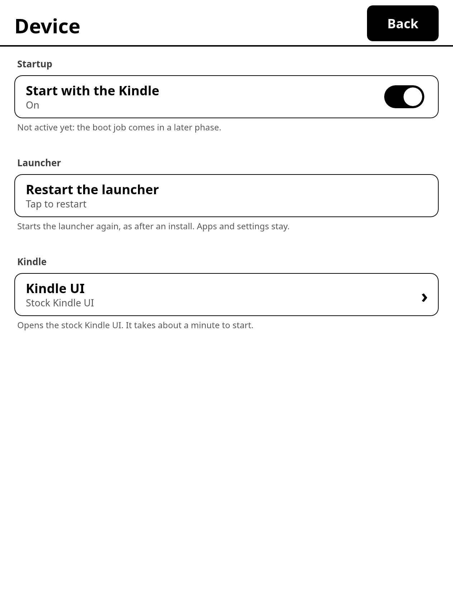<br><sub>Device settings</sub></td>
    <td align="center">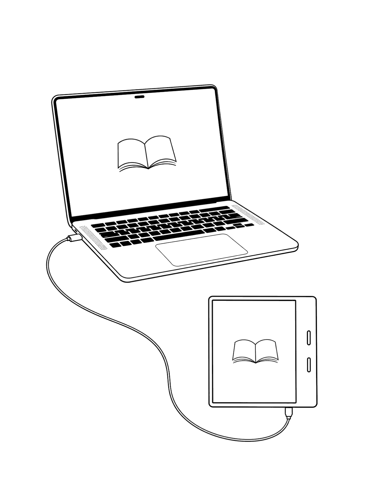<br><sub>USB drive mode, with the cable</sub></td>
  </tr>
</table>

## Highlights

| | |
|---|---|
| 🏠 **One grid** | Rounded-square icons of one size, 4 × 5 per page, pages with dots; swipe or use the page buttons. |
| 👆 **Calm on e-ink** | A tap darkens only that icon, and only the changed part of the screen is redrawn. |
| ✨ **Opening animation** | A card grows from the icon when an app opens. It can be turned off. |
| 🌙 **Dark mode** | White on black for the home screen, Settings, menus and dialogs. Picture icons keep their look. |
| ✏️ **Edit in place** | Long-press an app to move it, change its icon or hide it. |
| 🧩 **Apps found by themselves** | Library entries (`documents/*.sh`), KUAL extensions behind one Extensions tile, and `apps.toml` entries. |
| 🔄 **Turns with the Kindle** | Upright or upside down, read from the accelerometer even with the framework stopped. |
| 🔋 **Device controls** | Frontlight, warmth, Wi-Fi, SSH, battery and Wi-Fi icons, low-battery warnings. |
| 🛟 **Safe by design** | The stock UI is one tap away, and comes back by itself after repeated crashes or a hang. Nothing of the Kindle's own software is changed. |

## Status

| Device | Status |
|---|---|
| Kindle Oasis 3 (1264 × 1680, firmware 5.18.2) | ✅ Verified on hardware |
| Other Kindle models | 🛠️ Not supported yet |

**Current version: 0.3.12.** Each device build is a new patch version; each phase starts a new minor version.
Hardware observations are in the [device notes](docs/device-notes.md).

## Limits

- Verified on the Oasis 3 only.
- Starting at boot is opt-in and still being tested (M7): open *Launcher* from the library after a restart.
- USB: plugging the cable in shows the drive on the computer with the launcher's drive-mode picture; ejecting returns
  to the grid. Only the Oasis 3 is tested.
- Wi-Fi can be switched on and off, and networks can be joined with a password, including hidden networks. Enterprise
  networks are not supported yet.
- Returning to the Kindle UI takes about a minute: that is the stock framework starting.
- Amazon content (the store, purchased books, Whispersync) is in the Kindle UI only.

## Roadmap

The milestones and their checklists are in the [plan](docs/03-plan.md).

- [x] M1: the launcher with the framework stopped (apps, sleep and wake, the Kindle UI round trip)
- [x] M2: the home screen in the style of a phone (grid, pages, tap feedback, animation, dark mode, pop-ups)
- [x] M3: a status bar like the stock Kindle's, with Wi-Fi signal bars and quick settings
- [x] M4: Settings in pages (Wi-Fi, Display, Sleep, Apps, Device, About; SSH and DNS)
- [x] M5: Wi-Fi networks: scan, join with a password or by name, forget (enterprise networks skipped for now)
- [x] M6: USB drive mode from the launcher (network time was not needed)
- [ ] M7: start at boot (opt-in), with reboot tests
- [ ] M8: the rest of KUAL (`status`, `checked`); model checks are in

<details>
<summary><b>Using the launcher</b></summary>

- **Open apps.** Tap an icon. Library entries in `documents/` appear by themselves; more can be added in
  `launcher/apps.toml` (see `launcher/apps.toml.example`).
- **Pages.** Swipe left or right, or use the page buttons. The dots at the bottom show the page.
- **Edit.** Long-press an app: Move earlier, Move later, Change icon (PNG files in `launcher/icons/`), Hide.
  Settings › Hidden apps shows them again.
- **Settings.** Tap the status bar or the Settings icon.
- **Kindle UI.** Tap its icon and confirm. To come back, open *Launcher* in the Kindle library.
- **Sleep.** The power button and the cover work as usual. With Settings › Sleep screen set to the launcher's own,
  PNG files in `launcher/screensavers/` are shown in turn.
- **KOReader** runs through `launcher/run-koreader.sh`, so leaving it returns to the launcher.

Your settings live in `launcher/settings.txt` and `launcher/apps.toml`. The log is `launcher/log-launcher.txt`.

</details>

<details>
<summary><b>Build from source</b></summary>

Requirements: Rust (stable), the `armv7-unknown-linux-musleabihf` target, [zig](https://ziglang.org) and
[cargo-zigbuild](https://github.com/rust-cross/cargo-zigbuild).

```sh
cargo build --release --workspace                                        # desktop build
cargo zigbuild --release -p kl-kindle --target armv7-unknown-linux-musleabihf
scripts/package-release.sh                                               # dist/primitive-launcher-<version>.zip
```

To install a build onto the Kindle over SSH, run `sh deploy/install-ssh.sh`. To build, bump the patch version
and install in one step, run `scripts/build-device.sh` (`--minor` for a new phase).

</details>

<details>
<summary><b>Tests and CI</b></summary>

```sh
cargo test --workspace                       # app discovery, layout, UI states, drawing, device logic
sh tests/supervisor-test.sh                  # the supervisor against stub Kindle commands
sh tests/boot-test.sh                        # the boot guard
sh tests/library-entry-test.sh               # the library entry
sh tests/koreader-wrapper-test.sh            # the KOReader wrapper
cargo run --release -p kl-desktop -- --documents DIR --out out/   # every screen as PNG
```

The [CI workflow](.github/workflows/ci.yml) runs the unit tests, clippy, the shell suites, the desktop
screenshots and the ARMv7 build on every push and pull request. The
[release workflow](.github/workflows/release.yml) builds and publishes the package when a `v*` tag is pushed.

Desktop results are not hardware results. Each milestone is checked on the Kindle with the user watching;
see the [plan](docs/03-plan.md).

</details>

<details>
<summary><b>Project structure</b></summary>

```text
crates/kl-core      App discovery (scriptlets, apps.toml, KUAL), settings, layout, UI state machine
crates/kl-render    Drawing to an 8-bit gray buffer (vello_cpu, parley), icons, dithering, dark mode
crates/kl-kindle    The device binary kl-launcher: e-ink, touch, buttons, power events, accelerometer, lipc
crates/kl-desktop   Desktop driver that writes PNG screenshots (testing); draws the library icon
deploy/             Supervisor, library entry, KOReader wrapper, boot job (not installed yet), SSH installer
scripts/            Device build and release packaging
tests/              Shell suites against stub Kindle commands
assets/             Fonts and icons
docs/               Research, requirements, architecture, plan, device notes, install guide, changelog
```

</details>

## Documentation

- 📘 [Install on a Kindle](docs/INSTALL.md)
- 🗺️ [Plan and milestones](docs/03-plan.md)
- 🔬 [Device notes from hardware testing](docs/device-notes.md)
- 📚 [Research](docs/00-research.md) · [Requirements](docs/01-requirements.md) ·
  [Architecture](docs/02-architecture.md)
- 📝 [Changelog](docs/CHANGELOG.md)

## Licence

Copyright (C) 2026 Doan Nguyen.

- **Code** (`crates/`, `deploy/`, `scripts/`, `tests/`), including Primitive Store: the
  [PolyForm Noncommercial License 1.0.0](LICENSE). You may use, change and share it for any non-commercial purpose.
  Commercial use needs the author's written permission.
- **Documentation and pictures** (this README, `docs/`, the icons, pictures and screenshots in `assets/` and
  `docs/images/`, except the Kindle icon below): [CC BY-NC-SA 4.0](LICENSE-DOCS).
- **Earlier versions**: releases up to and including **v0.3.20** were published under the GNU Affero General Public
  License v3.0 (AGPL-3.0), and those releases stay available under it. The new licences apply from the next version.

The e-ink, input and device code in `crates/kl-kindle` and some icon paths are copied from
[Primitive Browser](https://github.com/DoanNguyenTrong/kindle-primitive-browser), the same author's work, where they
remain under AGPL-3.0; each copied file says so at the top. The e-ink update structure follows the Kindle driver's
interface as described in FBInk's `eink/mxcfb-kindle.h`.

Third-party parts keep their own licences: the Noto Sans fonts are under the SIL Open Font License
(`assets/fonts/NOTO-LICENSE.txt`); Dropbear and zlib are under their licences in `assets/device/licenses/`.
Kindle is a trademark of Amazon.com, Inc. or its affiliates. This project is not affiliated with or endorsed by
Amazon. The Kindle UI tile uses the Kindle app icon (`assets/kindle-icon.png`, shown in gray as
`assets/icons/kindle-ui.png`) only to mark the button that opens the Kindle's own interface. If Amazon wants it
taken down, please reach out to us, by opening an issue or contacting the maintainer, and we will remove it.

## Security

Report security problems privately to the maintainer rather than in a public issue.
